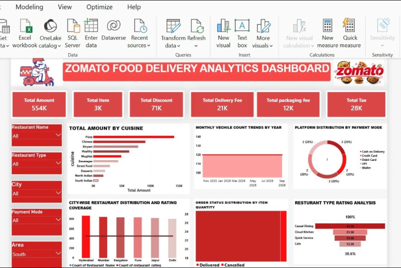
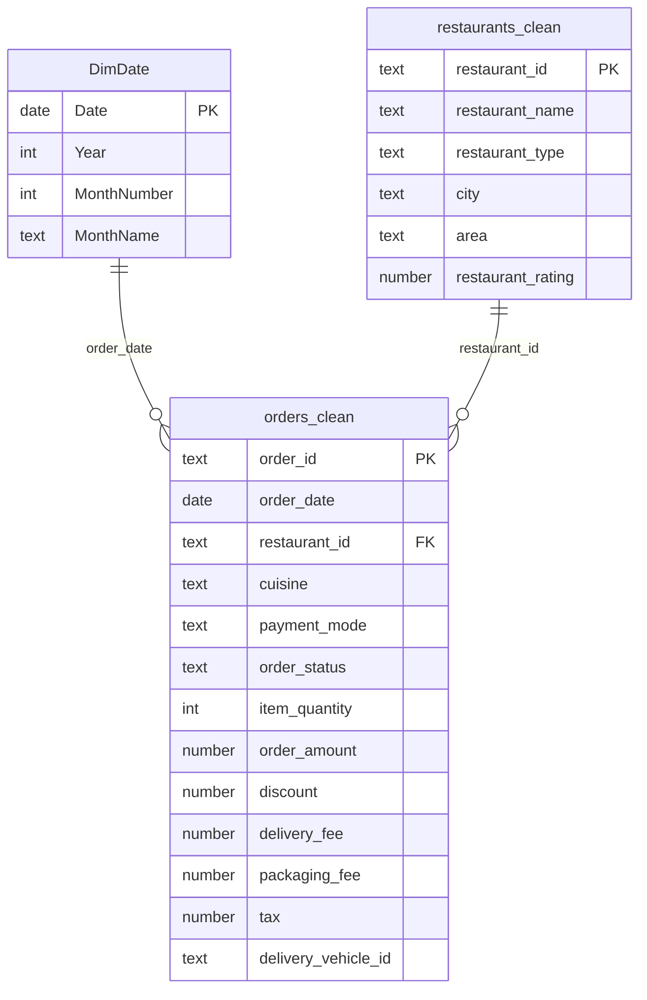

<div align="center">

# 🍽️ Zomato-Style Food Delivery Analytics Dashboard

**Python · SQL · Power Query · DAX · Microsoft Power BI**

*End-to-end analytics project on restaurant performance, orders, payments and delivery operations*


</div>

> **Independent portfolio project, not affiliated with Zomato.** All data is **synthetic**.

---

## 📑 Table of Contents
1. [Project Overview](#1-project-overview)
2. [Project Status](#2-project-status)
3. [Dashboard Preview](#3-dashboard-preview)
4. [Business Problem & Objectives](#4-business-problem--objectives)
5. [Dataset](#5-dataset)
6. [Tools & Technologies](#6-tools--technologies)
7. [Repository Structure](#7-repository-structure)
8. [Data Cleaning Methodology](#8-data-cleaning-methodology)
9. [Data Model](#9-data-model)
10. [Dashboard Features & Slicers](#10-dashboard-features--slicers)
11. [KPI Definitions](#11-kpi-definitions)
12. [SQL Analysis Examples](#12-sql-analysis-examples)
13. [Key Findings](#13-key-findings)
14. [How to Reproduce the Analysis](#14-how-to-reproduce-the-analysis)
15. [How to Build / Open the Power BI Report](#15-how-to-build--open-the-power-bi-report)
16. [Limitations & Future Improvements](#16-limitations--future-improvements)
17. [Author](#17-author)

---

## 1. Project Overview
This project analyses a food-delivery business across **60 restaurants, 6 cities and 1,200 orders** (Nov 2025 – Sep 2026).
It covers the full analyst workflow: data generation and cleaning in Python, business analysis in SQL, a star-schema data
model with Power Query and DAX, and a dashboard design with **6 KPI cards, 5 slicers and 6 core visuals**.

## 2. Project Status
| Component | Status |
|---|---|
| Synthetic dataset (raw + cleaned) | ✅ Done |
| Python cleaning, EDA, KPI cross-check | ✅ Executed |
| SQL analysis (13 queries) | ✅ Executed, results match Python |
| Power Query (M), DAX, data model docs | 📝 Documented, **not yet validated in Power BI Desktop** |
| `.pbix` report file | ⏳ Not yet created |
| Screenshots of this project's own dashboard | ⏳ Pending (see section 3) |

## 3. Dashboard Preview

**Reference layout this project targets:**



> ⚠️ This image is the **design reference** (layout, colours, visual types) used as the build target. Its figures
> (e.g. 554K total amount) come from a different dataset and do **not** match this repository's data (596,782).
> It will be replaced by `screenshots/dashboard_overview.png` once the `.pbix` is built from this repo's data.

**Target layout**

| Zone | Content |
|---|---|
| Header | Title banner + food-delivery illustration |
| Row 1 | 6 KPI cards |
| Left column | 5 slicers |
| Row 2 | Cuisine bars · Monthly vehicle trend · Payment-mode donut |
| Row 3 | City restaurants & rating · Order status by item quantity · Restaurant-type rating |

## 4. Business Problem & Objectives
**Problem:** A delivery platform needs a single view of revenue, fees, restaurant quality and order outcomes.

**Objectives**
- Track order value, items, discounts, delivery/packaging fees and tax.
- Identify top cuisines, cities and restaurant types.
- Understand payment-mode mix and order outcomes (delivered / cancelled / refunded).
- Monitor delivery-vehicle activity and monthly revenue trend.

## 5. Dataset
- **Type:** synthetic, generated by `python/generate_synthetic_data.py` (fixed seed 42). Not real Zomato data.
- **Why:** no suitable public dataset was reachable in the build environment.
- **Tables:** `restaurants` (60 rows) and `orders` (1,200 clean rows).
- **Injected quality issues** (to demonstrate cleaning): 15 duplicate rows, 12 null payment modes, inconsistent casing/whitespace.
- **License:** project code and data are MIT-licensed; see [`data/README.md`](data/README.md).

| Table | Key columns |
|---|---|
| `orders` | order_id, order_timestamp, restaurant_id, cuisine, payment_mode, order_status, item_quantity, order_amount, discount, delivery_fee, packaging_fee, tax, delivery_vehicle_id |
| `restaurants` | restaurant_id, restaurant_name, restaurant_type, city, area, primary_cuisine, restaurant_rating |

## 6. Tools & Technologies
| Layer | Tools |
|---|---|
| Data prep & EDA | Python, Pandas, NumPy, Matplotlib |
| Analysis | SQL (SQLite; PostgreSQL notes) with CTEs and window functions |
| Transformation | Power Query (M) |
| Modelling & measures | Power BI, DAX, star schema |
| Version control | Git, GitHub |

## 7. Repository Structure
```
zomato-food-delivery-analytics/
├── README.md
├── LICENSE
├── requirements.txt
├── data/
│   ├── README.md
│   ├── raw/                  # generated raw CSVs (with injected issues)
│   └── processed/            # cleaned CSVs used by SQL and Power BI
├── python/
│   ├── generate_synthetic_data.py
│   ├── data_cleaning.py
│   ├── eda_analysis.py
│   ├── run_sql_validation.py
│   └── requirements.txt
├── sql/
│   └── zomato_analysis.sql
├── powerbi/
│   ├── data_model.md
│   ├── power_query_steps.md
│   └── dax_measures.md
├── docs/
│   ├── methodology.md
│   ├── insights.md
│   ├── kpi_summary.csv
│   └── python_eda_charts/    # matplotlib previews (not Power BI)
└── screenshots/
    └── reference_dashboard_design.png
```

## 8. Data Cleaning Methodology
Implemented in [`python/data_cleaning.py`](python/data_cleaning.py):

1. Load raw CSVs and parse timestamps.
2. Trim whitespace; title-case cities; normalise order-status casing.
3. Remove **15** exact duplicate rows (no duplicate `order_id` remains).
4. Replace **12** null payment modes with `Unknown` (not guessed).
5. Validate: non-negative amounts, discount ≤ amount, valid restaurant keys, ratings between 1 and 5.
6. Flag **4** high-value outliers (IQR rule) but keep them.
7. Export cleaned CSVs to `data/processed/`.

## 9. Data Model
Star schema with an order-level fact table. Full detail: [`powerbi/data_model.md`](powerbi/data_model.md).


Both relationships are many-to-one with single-direction filtering (dimension → fact).

## 10. Dashboard Features & Slicers
**Slicers:** Restaurant Name · Restaurant Type · City · Payment Mode · Area

**Visuals**
| # | Visual | Chart | Fields |
|---|---|---|---|
| 1 | Cuisine-wise total order amount | Horizontal bar (sorted desc) | cuisine, Total Order Amount |
| 2 | Monthly vehicle count trend | Area / line | YearMonth, Vehicle Count |
| 3 | Payment mode distribution | Donut with % | payment_mode, Total Orders |
| 4 | City-wise restaurants & ratings | Column + separate rating visual | city, Total Restaurants, Average Restaurant Rating |
| 5 | Order status by item quantity | Stacked bar | order_status, Total Items, Total Orders |
| 6 | Restaurant-type rating | Horizontal bar (sorted desc) | restaurant_type, Average Restaurant Rating |

## 11. KPI Definitions
All measures are in [`powerbi/dax_measures.md`](powerbi/dax_measures.md).

| KPI | Definition | Value (this dataset) |
|---|---|---|
| Total Order Amount | Sum of item subtotal, all statuses | 596,782.16 |
| Total Items | Sum of item quantity | 3,148 |
| Total Discount | Sum of discounts | 42,787.00 |
| Total Delivery Fee | Sum of delivery fees | 31,440.00 |
| Total Packaging Fee | Sum of packaging fees | 13,930.00 |
| Total Tax | Sum of tax | 27,699.83 |
| Total Orders | Distinct `order_id` | 1,200 |
| Average Order Value | Total Order Amount ÷ Total Orders | 497.32 |
| Cancellation Rate | Cancelled ÷ total orders | 6.67% |

## 12. SQL Analysis Examples
Full script: [`sql/zomato_analysis.sql`](sql/zomato_analysis.sql) (13 queries).

```sql
-- Top 10 restaurants by delivered revenue (CTE + window function)
WITH r AS (
  SELECT s.restaurant_name, s.city, SUM(o.order_amount) AS revenue
  FROM orders o JOIN restaurants s USING (restaurant_id)
  WHERE o.order_status = 'Delivered'
  GROUP BY s.restaurant_id)
SELECT RANK() OVER (ORDER BY revenue DESC) AS rnk, restaurant_name, city, ROUND(revenue,0) AS revenue
FROM r ORDER BY rnk LIMIT 10;
```
```sql
-- Monthly revenue with month-over-month change
WITH m AS (
  SELECT strftime('%Y-%m', order_timestamp) AS month, SUM(order_amount) AS revenue
  FROM orders GROUP BY month)
SELECT month, ROUND(revenue,0) AS revenue,
       ROUND(100.0*(revenue - LAG(revenue) OVER (ORDER BY month)) / LAG(revenue) OVER (ORDER BY month),1) AS mom_pct
FROM m ORDER BY month;
```

## 13. Key Findings
> Computed from the **synthetic** dataset; patterns mainly reflect the generator's settings, so they demonstrate the
> workflow rather than real market behaviour. Source: [`docs/insights.md`](docs/insights.md).

- **Cuisine:** Pizza leads (168,159), then Chinese (94,821) and North Indian (94,267); Beverages is lowest (15,043).
- **Payments:** UPI is the top mode at 45.6% of orders, then Cash on Delivery (19.4%).
- **Order outcomes:** 1,087 delivered (90.6%), 80 cancelled (6.67%), 33 refunded (2.75%).
- **Ratings:** Casual Dining is highest (4.18); Cafe is lowest (3.48, only 6 restaurants, so a small sample).
- **Trend:** monthly revenue ranges from 39,888 (Feb 2026) to 62,999 (Apr 2026); distinct vehicles per month stay between 33 and 39.

## 14. How to Reproduce the Analysis
```bash
git clone https://github.com/Munishx01/zomato-food-delivery-analytics.git
cd zomato-food-delivery-analytics
pip install -r requirements.txt

python python/generate_synthetic_data.py   # creates data/raw/
python python/data_cleaning.py             # creates data/processed/
python python/eda_analysis.py              # KPI summary + preview charts
python python/run_sql_validation.py        # runs sql/zomato_analysis.sql on SQLite
```
Expected check: SQL and pandas both report total order amount **596,782.16** and **1,200** orders.

## 15. How to Build / Open the Power BI Report
1. Open **Power BI Desktop** → *Get Data → Text/CSV*, or follow [`powerbi/power_query_steps.md`](powerbi/power_query_steps.md) with a `DataPath` parameter pointing to `data/processed/`.
2. Create the `DimDate` table and relationships from [`powerbi/data_model.md`](powerbi/data_model.md); mark `DimDate` as a date table.
3. Add the measures from [`powerbi/dax_measures.md`](powerbi/dax_measures.md).
4. Build the layout in section 3 (6 KPI cards, 5 slicers, 6 visuals) in a 16:9 canvas with a red/white theme.
5. Save as `powerbi/Zomato_Food_Delivery_Analytics.pbix` and export screenshots to `screenshots/`.
6. To refresh: update `DataPath` if the folder moved, then *Home → Refresh*.

## 16. Limitations & Future Improvements
**Limitations**
- Data is synthetic; findings are illustrative.
- Vehicle Count is distinct vehicles with orders (no fleet table).
- Total Order Amount includes cancelled and refunded orders; use a Delivered filter for realised revenue.
- Power BI artefacts are documented but not yet validated in Power BI Desktop.

**Future improvements**
- Build and publish the `.pbix` with real screenshots.
- Swap in a real public food-delivery dataset.
- Add a line-item table, delivery-time analysis and customer cohorts.
- Add row-level security and a mobile layout.

## 17. Author
**Munish Kumar**: Data Engineer
GitHub: [@Munishx01](https://github.com/Munishx01)

---
<div align="center">⭐ If this project helped you, consider giving it a star.</div>
